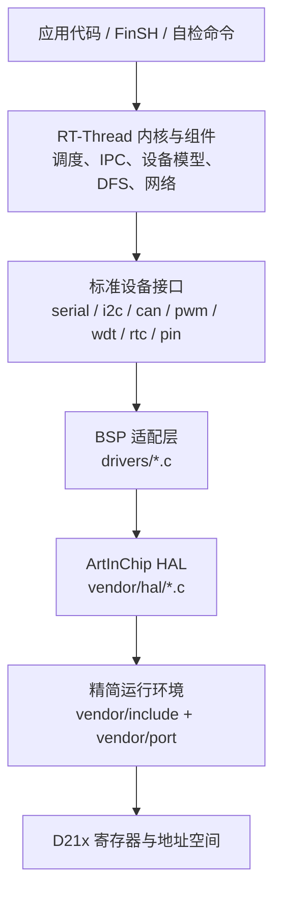
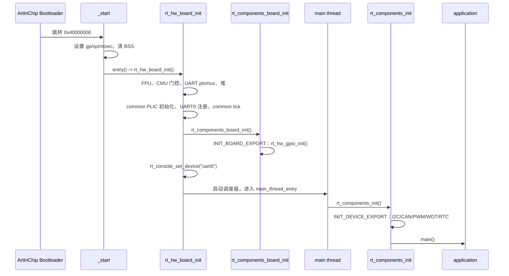
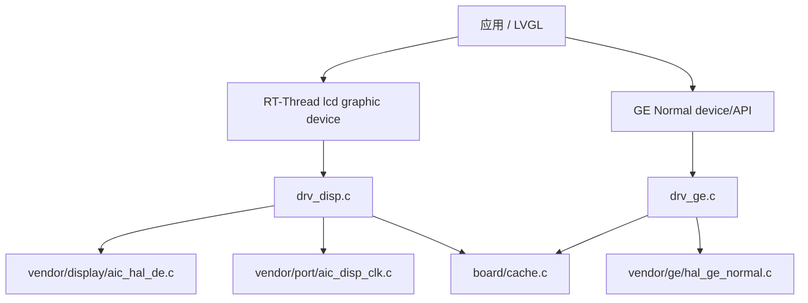
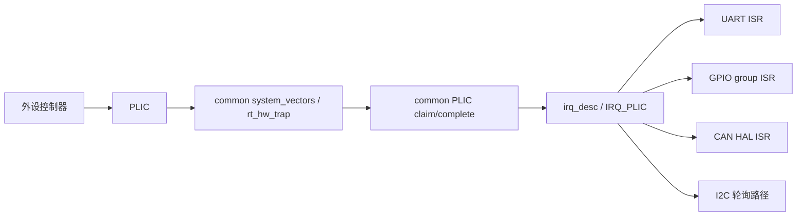
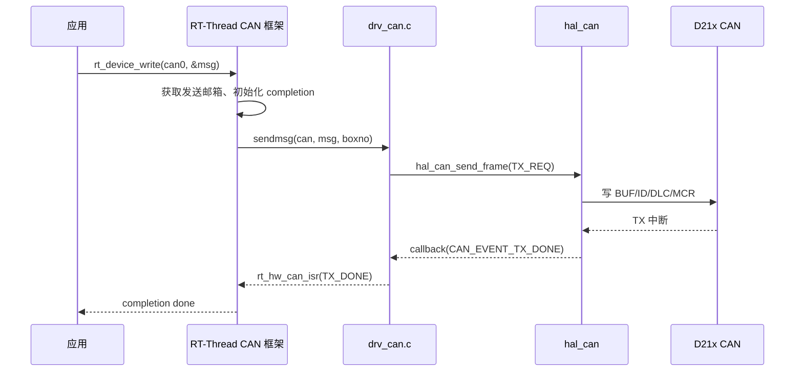

# 02 BSP 总体架构

## 2.1 分层关系



关键点：

1. **应用只依赖 RT-Thread 标准接口**。例如 CAN 应用使用 `rt_device_find`、`rt_device_open`、`rt_device_write`、`rt_device_read`，不直接调用 `hal_can_send_frame`。
2. **适配层只做“翻译”**。`drivers/drv_can.c` 把 `struct rt_can_ops` 映射到 `hal_can_*`；复杂位时序、过滤器和错误处理仍由原厂 HAL 完成。
3. **HAL 不依赖 Luban-Lite 的 OSAL**。`vendor/include/aic_compat.h` 提供类型、MMIO、日志、时间、`do_div` 等最小原语；`vendor/port/aic_hal_clk.c` 提供 D21x 的时钟门控/复位。
4. **原厂 HAL 文件逐字节未修改**。来源和 SHA-256 见 [20-vendor-source-license.md](20-vendor-source-license.md)。

## 2.2 启动与初始化层次

RT-Thread 的初始化导出分为多个级别。本 BSP 的实际顺序如下：



因此：

- GPIO 设备在 `rt_hw_board_init()` 内注册，早于控制台；
- UART0 在 `rt_hw_board_init()` 中直接注册，不依赖 `INIT_DEVICE_EXPORT`；
- I2C/CAN/PWM/WDT/RTC 在 `main()` 之前的组件初始化阶段注册；
- 应用代码可以安全地假设这些设备已存在，但仍应检查 `rt_device_find()` 返回值。

## 2.3 设备注册关系

| 设备名 | 驱动文件 | 注册函数 | 注册级别 | 依赖 |
|---|---|---|---|---|
| `uart0`..`uart7` | `drivers/drv_uart.c` | `rt_hw_serial_register` | `rt_hw_board_init` | `RT_USING_SERIAL` |
| `gpio` | `drivers/drv_gpio.c` | `rt_device_pin_register` | `INIT_BOARD_EXPORT` | `RT_USING_PIN` |
| `i2c0`..`i2c3` | `drivers/drv_i2c.c` | `rt_i2c_bus_device_register` | `INIT_DEVICE_EXPORT` | `RT_USING_I2C` |
| `can0`/`can1` | `drivers/drv_can.c` | `rt_hw_can_register` | `INIT_DEVICE_EXPORT` | `RT_USING_CAN` |
| `pwm` | `drivers/drv_pwm.c` | `rt_device_pwm_register` | `INIT_DEVICE_EXPORT` | `RT_USING_PWM` |
| `wdt` | `drivers/drv_wdt.c` | `rt_hw_watchdog_register` | `INIT_DEVICE_EXPORT` | `RT_USING_WDT` |
| `rtc` | `drivers/drv_rtc.c` | `rt_hw_rtc_register` | `INIT_DEVICE_EXPORT` | `RT_USING_RTC` |
| `lcd` | `drivers/drv_disp.c` | `rt_device_register` | `INIT_DEVICE_EXPORT` | `BSP_USING_DISPLAY` |
| `ge` | `drivers/drv_ge.c` | `rt_device_register` | `INIT_DEVICE_EXPORT` | `BSP_USING_GE` |
| LVGL UI thread | 外部 `lvgl-aic-standalone` | `rt_thread_create` | MSH `lvgl_demo` | `BSP_USING_LVGL` + 外部组件 |

显示/GE 的额外分层：



Framebuffer 不在堆中分配，而由链接脚本保留在 DDR 顶部、
Bootloader 保留区之下；`AIC_FB_RESERVED_SIZE=0` 时该区域自动消失，
最小配置的内存布局保持不变。

## 2.4 中断关系



- UART、CAN、GPIO 使用中断；
- I2C 主机路径使用 HAL 的轮询/超时实现，不使用 I2C 中断；
- PWM/WDT/RTC 当前不注册中断（RTC 闹钟未实现）；
- PLIC 的 claim/complete、`irq_desc` 和 mask/umask 由
  `libcpu/risc-v/common` 完成，BSP 只提供 MMIO/PER quirk。

## 2.5 Kconfig 组织

```text
bsp/artinchip/d213-demo128-nand/Kconfig
├── source $(RTT_DIR)/Kconfig              # RT-Thread 主配置
├── source board/Kconfig                   # DDR 大小、Bootloader 保留区、UART 时钟
└── source drivers/Kconfig                 # 片上外设
    ├── BSP_USING_GPIO   -> select RT_USING_PIN
    ├── BSP_USING_UARTn  -> select RT_USING_SERIAL
    ├── BSP_USING_I2Cn  -> select RT_USING_I2C
    ├── BSP_USING_CANn  -> select RT_USING_CAN
    ├── BSP_USING_PWM   -> select RT_USING_PWM
    ├── BSP_USING_WDT   -> select RT_USING_WDT
    └── BSP_USING_RTC   -> select RT_USING_RTC
```

`select` 只负责拉起框架；具体实例仍由 `BSP_USING_*` 控制。未启用的实例不会把对应框架和驱动编进镜像。

## 2.6 SCons 组织

```text
SConstruct
├── 生成 link.lds（预处理 board/link.lds.S）
├── PrepareBuilding()
├── 遍历 applications/SConscript
├── 遍历 board/SConscript
├── 遍历 drivers/SConscript
├── 遍历 vendor/SConscript
└── DoBuilding()
```

`drivers/SConscript` 按 `GetDepend()` 条件加入源文件；`vendor/SConscript` 只为已启用的 HAL 编译对应 `.c`，并加入 `vendor/port/aic_hal_clk.c`。因此关闭所有外设时，`vendor/` 只编译 GPIO 所需的 HAL（GPIO 默认启用）。

## 2.7 为什么需要兼容层

Luban-Lite 的 HAL 原本依赖 `aic_core.h`、`aic_osal.h`、`aic_drv.h` 和完整 CMU 框架。直接复制整个 SDK 会带来：

- 与 RT-Thread 冲突的线程/中断抽象；
- 大量未使用驱动和包；
- 不可控的构建入口和全局配置；
- 难以审查的许可证与依赖边界。

本 BSP 的做法是：

1. 只复制实际使用的 HAL `.c`/`.h`；
2. 保持这些文件不变；
3. 用 `vendor/include/aic_compat.h` 提供最小原语；
4. 用 `vendor/port/aic_hal_clk.c` 提供 D21x 固定时钟树上的门控/复位；
5. 用 `drivers/*.c` 写标准 RT-Thread 适配。

这不是“重新实现 HAL”，而是**缩小运行环境**。CAN 位时序、I2C 控制器状态机、PWM 动作限定器仍然使用原厂实现。

## 2.8 数据与控制流示例：CAN 发送



这条链路说明：适配层不参与位时序和重传策略；它只负责结构体转换、模式映射和回调转发。

## 2.9 维护边界

- `board/`：SoC/板级初始化，允许按板卡修改；
- `drivers/`：RT-Thread 适配，允许按框架版本修改；
- `vendor/hal/`：原厂实现，原则上不改；必须修改时要在 [20-vendor-source-license.md](20-vendor-source-license.md) 记录差异；
- `vendor/include/`：兼容层，可随 HAL 升级调整；
- `vendor/port/aic_hal_clk.c`：BSP 自有代码，按 D21x 时钟表维护；
- `pack/`、`tools/`：打包链，不得随意改变分区或 Bootloader 参数。
