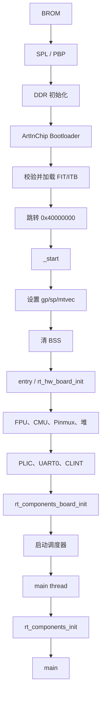

# 04 系统启动与内核移植

## 4.1 从加电到 `main()` 的完整链路



### BROM

D21x 片内 Boot ROM 根据启动介质顺序选择 SD、SPI NAND、SPI NOR 或 eMMC，加载原厂 SPL/PBP。BSP 不参与这一阶段。

### SPL / PBP / Bootloader

原厂 Bootloader 完成：

- DDR3 初始化（参数来自 `ddr_init.json`）；
- SPI NAND 控制器初始化；
- 分区表解析；
- FIT/ITB 校验与加载；
- 跳转到 OS 入口。

D213 demo128 的 Bootloader 位于 DDR 顶部附近：加载地址 `0x47B80000`，入口 `0x47B80100`。BSP 在堆布局中保留顶部 8 MB，防止覆盖 Bootloader。

### FIT/ITB

`tools/mk_firmware.py` 调用原厂 `mk_image.py` 的 `elf2itb` 流程，把 `rtthread.elf` 转成 `d21x_os.itb`，再与 `bootloader.aic`、`env.bin`、DDR 初始化资源打包为 `.img`。

FIT 的加载地址和入口地址都是 `0x40000000`。

## 4.2 `_start` 汇编

`board/start_gcc.S` 做最少的工作：

1. 设置 `gp`（全局指针）；
2. 关闭 `mie`/`mip`；
3. 设置 `mtvec = trap_entry`；
4. 设置启动栈 `sp = __rt_rvstack`；
5. 置 `mstatus.FS = 1`，启用 FPU；
6. 清零 `__bss_start__` 到 `__bss_end__`；
7. 调用 `entry()`。

不在此处初始化 DDR、PLL 或 NAND；这些已由 Bootloader 完成。

## 4.3 C Runtime 与板级初始化

`rt_hw_board_init()` 的顺序：

```c
aic_cpu_init();                 /* FPU + C906 mxstatus */
aic_board_sysclk_init();        /* 外设门控与复位 */
aic_board_pinmux_init();        /* UART 引脚 */
rt_system_heap_init(...);       /* DDR 堆 */
rt_hw_interrupt_init();         /* PLIC */
rt_hw_serial_init();            /* UART0/1/... */
rt_hw_tick_init();              /* CLINT */
rt_components_board_init();     /* GPIO 等 INIT_BOARD_EXPORT */
rt_console_set_device("uart0");
```

注意：`rt_hw_serial_init()` 直接注册 UART，不依赖 `INIT_DEVICE_EXPORT`；因此控制台在组件初始化之前就可用。

## 4.4 Machine Mode

D21x 的 RT-Thread 运行在 M-mode：

- `mtvec` 指向 `libcpu/risc-v/rv64/trap.c` 的 `trap_entry`；
- 机器定时器中断由 CLINT 产生；
- 机器外部中断由 PLIC 分发；
- 没有 S-mode、页表或用户态隔离。

这意味着：

- 所有驱动都在最高特权级，错误指针可能直接导致系统异常；
- 没有 MMU 保护，DMA 缓冲区必须按物理地址理解；
- 中断上下文不能调用可能睡眠的 API。

## 4.5 Trap 与异常

`libcpu/risc-v/rv64/trap.c` 负责保存/恢复现场，并调用：

- `rt_hw_tick_isr()`：机器定时器；
- `rt_hw_irq_isr()`：机器外部中断；
- 异常处理：打印 `mcause`、`mepc`、`mtval` 等信息。

当前 BSP 没有额外的异常诊断扩展。若出现异常，先确认：

1. `mepc` 是否落在合法代码段；
2. `mtval` 是否是非法访问地址；
3. 栈是否溢出（`RT_USING_OVERFLOW_CHECK` 已启用）；
4. 中断是否在未初始化 PLIC 的情况下被打开。

## 4.6 FPU 上下文

RISC-V 通用 Port 在上下文切换时保存/恢复 `f0`-`f31`，但**不保存 `fcsr`**。这来自上游 `libcpu/risc-v/common` 的实现，本 BSP 没有修改内核。

影响：

- 普通浮点运算、函数调用和线程切换是安全的；
- 如果两个线程使用不同的舍入模式、异常标志或动态精度，`fcsr` 可能互相影响；
- 需要严格 IEEE 状态隔离的产品必须修改 CPU Port 或在应用层保存/恢复 `fcsr`。

`applications/fpu_test_gcc.S` 验证的是 callee-saved 浮点寄存器在真实线程切换后的值，不验证 `fcsr`。

## 4.7 内存布局

```text
0x40000000  .text / .rodata / .data
            .bss
            interrupt stack
            heap
0x45800000  __fb_start（显示配置：32 MB Framebuffer 保留区）
0x47800000  __fb_end / heap end / Bootloader 保留区起点
0x47B80000  ArtInChip Bootloader
0x48000000  DDR end (128 MB)
```

显示关闭时 `AIC_FB_RESERVED_SIZE=0`，`__fb_start = __heap_end = 0x47800000`，原最小堆布局不变。

链接脚本 `board/link.lds.S` 在构建时由 SCons 预处理生成 `link.lds`，并包含以下断言：

- `.data`/`.bss` 不越过堆起点；
- 堆结束早于 Bootloader 保留区；
- 中断栈位于合法 RAM；
- 入口为 `_start`。

`AIC_BOOTLOADER_RESERVED_SIZE` 默认 `0x800000`（8 MB）。不要为了让镜像变大而删除这个保留区。

## 4.8 Tick 与长期计时

`board/tick.c` 使用 CLINT `mtime`/`mtimecmp`：

- `BSP_CLINT_FREQ = 4000000`；
- `RT_TICK_PER_SECOND = 1000`；
- 每次中断把 `mtimecmp` 增加固定间隔，而不是从“当前时间”重新计算；
- 如果已经落后超过一个间隔，则从当前时间重新起步，避免中断风暴。

因此正常负载下不会因为中断延迟累积 Tick 漂移；长时间断电或调试暂停后，系统时间不会补偿停机时间。

## 4.9 中断栈

`AIC_INTERRUPT_STACK_SIZE` 默认 `0x2000`（8 KB）。中断栈用于 Trap 现场和 ISR 调用链。若后续接入显示/网络/文件系统并在中断中做大量工作，应评估增大该值，或把耗时工作移到线程。

## 4.10 启动失败排查顺序

1. 串口是否有 Bootloader 日志：没有则检查供电、启动介质、串口线；
2. 是否打印 `RT-Thread 5.3.0`：没有则检查 FIT 加载地址、入口、镜像是否写入 `os` 分区；
3. 是否卡在 PLIC/UART 初始化：检查 UART0 pinmux 和时钟门控；
4. 是否在 `main()` 前异常：检查新增 `INIT_DEVICE_EXPORT` 驱动；
5. 是否反复重启：检查看门狗是否被意外启动、堆是否覆盖 Bootloader。

详细测试方法见 [17-testing-troubleshooting.md](17-testing-troubleshooting.md)。
