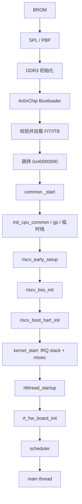

# 04 系统启动与内核移植

本 BSP 已迁移到 RT-Thread 官方 **Next RISC-V common port**（PR #10320）。
启动、Trap、上下文切换、中断控制器适配和定时器核心来自
`libcpu/risc-v/common`，D213 BSP 只保留板/SoC 相关部分。

## 4.1 从加电到 `main()`



### Bootloader

原厂 Bootloader 完成 DDR3、SPI NAND、分区表和 FIT 校验，然后跳到
`0x40000000`。BSP 不重复初始化 DDR/PLL/NAND。

D213 demo128 Bootloader 位于 DDR 顶部附近：加载地址
`0x47B80000`，入口 `0x47B80100`。BSP 堆布局保留顶部 8 MB。

### Common Startup

`libcpu/risc-v/common/startup_gcc.S`：

1. 读取 `mhartid`，保存 `a1`；
2. `init_cpu_common()`：清 `mie/mip`、设置 `gp`、清 `FS/VS`、清
   `mscratch`；
3. 使用 `.percpu` 中的早期栈；
4. 调用 BSP 可覆盖的 `riscv_early_setup()`；
5. 清 `__bss_start..__bss_end`；
6. `riscv_boot_hart_init()`；
7. `kernel_start`：初始化中断栈，设置 `mtvec = system_vectors`，
   进入 `rtthread_startup()`。

D213 没有提供 BSP 根目录 `startup_gcc.S`，因此使用 common startup。
板级差异通过 `board/board.c` 和 `rt_hw_board_init()` 完成。

## 4.2 板级初始化

```c
riscv_isa_ext_set(I/M/A/F/D/C);
aic_cpu_init();                 /* FPU FS、C906 mxstatus */
aic_board_sysclk_init();
aic_board_pinmux_init();
rt_system_heap_init(...);
rt_hw_interrupt_init();         /* common PLIC + local INTC */
aic_plic_quirk_init();          /* D21x PER 寄存器 */
riscv_timer_set_frequency(BSP_CLINT_FREQ);
rt_hw_tick_init();              /* common riscv_timer */
rt_hw_serial_init();
rt_components_board_init();
rt_console_set_device("uart0");
```

`rt_hw_serial_init()` 直接注册 UART，因此控制台在组件初始化前可用。

## 4.3 Machine Mode 与 Trap

- `mtvec = system_vectors`（direct mode）；
- `rt_hw_trap()` 位于 `libcpu/risc-v/common/trap.c`；
- 机器定时器 IRQ 7 由 `riscv_timer_isr()` 处理；
- 机器外部 IRQ 11 由 common PLIC 处理；
- `rt_hw_interrupt_install()`、mask/umask 由 common 提供；
- 外设中断必须使用 `IRQ_PLIC(hwirq)`，不能把硬件 IRQ 号直接当
  框架 IRQ 号。

D213 的 PLIC 布局与标准 SiFive PLIC 兼容，额外需要写
`0x20000000 + 0x1FFFFC` 的 PER 位。该操作由
`board/interrupt.c:aic_plic_quirk_init()` 完成。

## 4.4 FPU 上下文

上游 common port 原先只在 Trap 路径保存浮点寄存器，直接线程切换
路径不保存 FPU。本分支对
`libcpu/risc-v/common/context_gcc.S` 和 `stack.c` 做了最小补丁：

- 直接线程切换保存/恢复 `f0`-`f31`；
- 保存/恢复 `fcsr`；
- 切换帧按 16 字节对齐；
- 新线程帧包含 FPU/fcsr 区域。

`applications/fpu_test_gcc.S` 验证 callee-saved 浮点寄存器在真实
线程切换后的值。该测试是 HW 验证项，当前 BUILD/STATIC PASS，实机
结果待补。

## 4.5 内存布局

```text
0x40000000  .text / .rodata / .data
            .bss
            .percpu（common 早期栈 + IRQ 栈在 .bss）
            heap
0x45800000  __fb_start（显示配置：32 MB Framebuffer 保留区）
0x47800000  __fb_end / heap end / Bootloader 保留区起点
0x47B80000  ArtInChip Bootloader
0x48000000  DDR end (128 MB)
```

链接脚本 `board/link.lds.S` 由 SCons 预处理生成 `link.lds`，提供
common port 需要的：

- `__text_start`、`__bss_start/__bss_end`；
- `__percpu_start/__percpu_end/__percpu_real_end`；
- `_end`；
- `__heap_start/__heap_end`。

并断言 `.data`/`.bss`/`.percpu` 不越过堆起点。

## 4.6 Tick

common `riscv_timer.c` 负责 Tick；BSP 只覆盖：

- `riscv_timer_rdtime()`：读取 C906 `rdtime` CSR；
- `riscv_timer_set_compare()`：写 `0x24004000` 的 `mtimecmp`；
- `rt_hw_get_clock_timer_freq()`：返回 `BSP_CLINT_FREQ = 4 MHz`。

`RT_TICK_PER_SECOND = 1000`，tick 间隔 4000 个 CLINT 周期。

## 4.7 中断栈

common port 使用 `ARCH_RISCV_USING_IRQ_STACK`，每个 CPU 在 `.bss`
中分配 `ARCH_RISCV_IRQ_STACK_SIZE`（默认 1024 字节）中断栈。Trap
现场保存在被中断线程栈上，C 级 `rt_hw_trap()` 在中断栈上运行。

如果后续在 ISR 中增加深调用链，可在 Kconfig 增大
`ARCH_RISCV_IRQ_STACK_SIZE`。

## 4.8 启动失败排查

1. 无 Bootloader 日志：检查供电、启动介质、串口；
2. 无 RT-Thread banner：检查 FIT 加载地址、入口、`os` 分区；
3. 卡在 PLIC/UART：检查 UART0 pinmux、时钟门控、PLIC PER；
4. `main()` 前异常：检查 `riscv_early_setup`、栈和新增
   `INIT_DEVICE_EXPORT` 驱动；
5. 反复重启：检查看门狗、堆是否覆盖 Bootloader。
