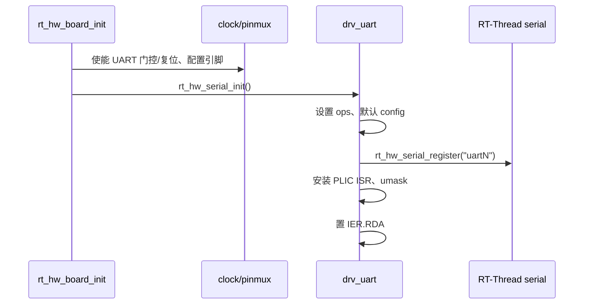

# 07 UART 开发手册

## 7.1 硬件能力

D21x 提供 8 个 UART 实例（UART0-UART7），本 BSP 全部支持编译。D213 demo128 实际引出的实例：

| 实例 | 引脚 | 用途 | 备注 |
|---|---|---|---|
| UART0 | PA.0/PA.1 | 调试控制台 | 默认启用 |
| UART1 | PA.4/PA.5 | RS-232 | 可选 |
| UART2 | PA.8/PA.9 | 串口 | 与 I2C2 冲突 |
| UART4 | PB.6/PB.7 | 串口 | 与 SDMC0/QSPI0 冲突 |
| UART3/5/6/7 | 未定义 | — | 可编译，需板级 pinmux |

输入时钟：48 MHz。最大波特率受控制器和引脚质量限制；常见 115200、921600、1.5 Mbps 可用，但**尚未做误码率测试**。

## 7.2 驱动组织

- `drivers/drv_uart.c`：RT-Thread serial v1 适配；
- `board/clock.c`：UART 门控；
- `board/pinmux.c`：UART 引脚；
- 原厂 UART HAL 没有复制；当前驱动是 BSP 自有实现，寄存器序列参考 `aic_hal_uart.c`。

为什么不用原厂 `drv/uart`：

- 原厂驱动依赖 `aic_osal`、DMA、RS485 和 PM；
- 当前需求是稳定的 poll + RX 中断；
- 自有实现只有约 300 行，容易审查和裁剪。

这不违反“优先复用”原则：UART 是简单控制器，且现有最小实现已经实机验证；引入原厂完整驱动会增加 DMA/RS485/PM 依赖，收益不足。

## 7.3 Kconfig

```text
BSP_USING_UART0   (default y)
BSP_USING_UART1
BSP_USING_UART2
BSP_USING_UART3
BSP_USING_UART4
BSP_USING_UART5
BSP_USING_UART6
BSP_USING_UART7
BSP_UART_CLK_FREQ (default 48000000)
```

每个 UART 会 `select RT_USING_SERIAL`。串口框架版本为 v1（`RT_USING_SERIAL_V1`）。

## 7.4 初始化流程



`aic_uart_configure()` 会在首次打开/配置时设置：

- 数据位 5-8；
- 停止位 1/2；
- 校验 none/odd/even；
- 波特率分频；
- FIFO 使能和复位；
- RX 使能。

## 7.5 使用示例

### 发送

```c
rt_device_t dev = rt_device_find("uart1");
rt_device_open(dev, RT_DEVICE_FLAG_RDWR | RT_DEVICE_FLAG_INT_RX);
rt_device_write(dev, 0, "hello\r\n", 7);
```

`rt_device_write()` 最终调用 `aic_uart_putc()`，逐字节等待 THRE。当前没有 TX FIFO 批量/DMA 发送。

### 接收

```c
static struct rt_semaphore rx_sem;

static rt_err_t rx_ind(rt_device_t dev, rt_size_t size)
{
    rt_sem_release(&rx_sem);
    return RT_EOK;
}

rt_device_set_rx_indicate(dev, rx_ind);
rt_device_open(dev, RT_DEVICE_FLAG_RDWR | RT_DEVICE_FLAG_INT_RX);

while (1)
{
    char buf[64];
    rt_size_t n;

    rt_sem_take(&rx_sem, RT_WAITING_FOREVER);
    n = rt_device_read(dev, 0, buf, sizeof(buf));
    if (n)
        process(buf, n);
}
```

### 修改波特率

```c
struct serial_configure cfg = RT_SERIAL_CONFIG_DEFAULT;

cfg.baud_rate = 921600;
cfg.data_bits = DATA_BITS_8;
cfg.stop_bits = STOP_BITS_1;
cfg.parity = PARITY_NONE;
rt_device_control(dev, RT_DEVICE_CTRL_CONFIG, &cfg);
```

## 7.6 中断行为

ISR 读取 IIR：

| IIR 类型 | 处理 |
|---|---|
| RX data available | `rt_hw_serial_isr(RX_IND)` |
| RX timeout | `rt_hw_serial_isr(RX_IND)` |
| Line status | 读 LSR 清除 |
| THR empty | 未启用 TX 中断 |

RX FIFO 触发级别为 1/2（FCR 设置）。串口框架的 ring buffer 默认 64 字节（`RT_SERIAL_RB_BUFSZ`）。高吞吐场景应增大该值或改用 DMA。

## 7.7 错误处理

当前 `aic_uart_getc()` 读取 LSR 并在有错误标志时继续读数据；没有向上层报告 parity/framing/overrun。应用如果需要错误统计，应扩展 serial ops 或直接读 LSR。

已知限制：

- 无 DMA；
- 无硬件流控（RTS/CTS）；
- 无 RS485 方向控制；
- 无 9-bit 模式；
- 无软件流控；
- 未做长时间误码率/压力测试。

## 7.8 板级注意事项

1. UART2 与 I2C2 共用 PA.8/PA.9；
2. UART4 与 SDMC0/QSPI0 共用 PB.6/PB.7；
3. UART1 连接到 RS-232 收发器，电平为 RS-232，不是 TTL；
4. RS485 的 DE/RE 控制尚未实现，不能直接把 UART 当 RS485 使用；
5. 修改 pinmux 时，先确认没有其他已启用外设占用同一引脚。

## 7.9 测试建议

- 回环：TX 短接 RX，发送递增字节，检查接收一致性；
- 双机：两块板交叉连接 TX/RX/GND，跑 115200/921600；
- 长时间：连续传输 1 MB，统计丢字节和 overrun；
- 错误注入：故意发送错误校验位，确认 LSR 标志；
- 热插拔：反复插拔串口线，确认没有锁死。

这些测试目前都**未执行**，状态为 BUILD/STATIC。
