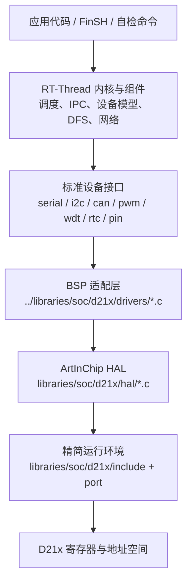
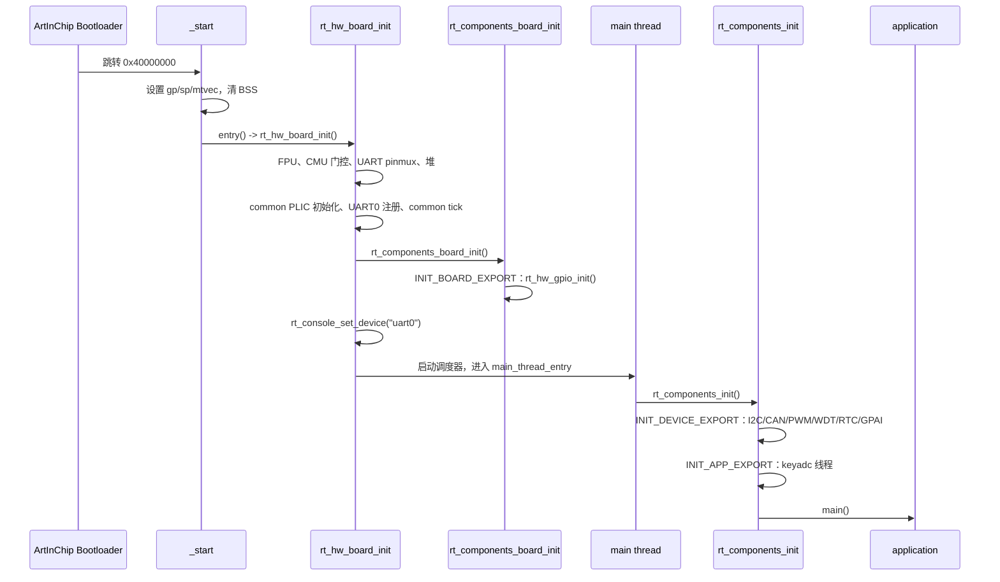
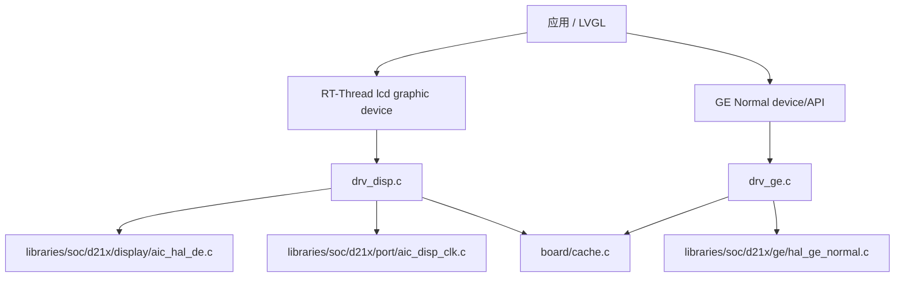
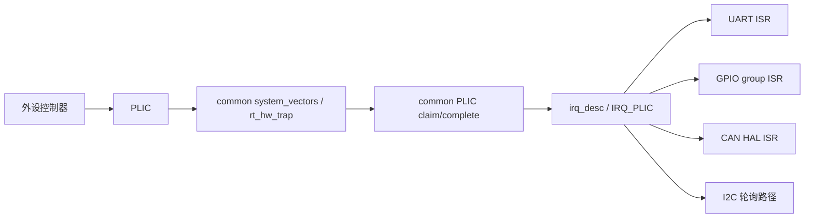
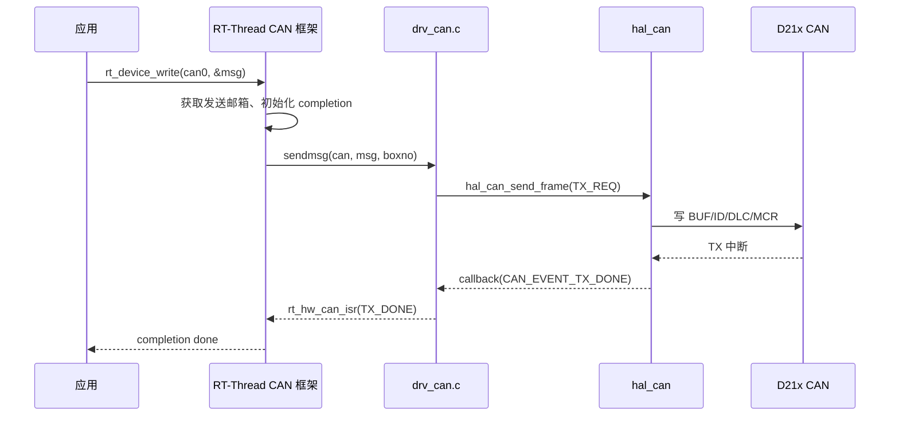

# 02 BSP 总体架构

## 2.1 分层关系



关键点：

1. **应用只依赖 RT-Thread 标准接口**。例如 CAN 应用使用 `rt_device_find`、`rt_device_open`、`rt_device_write`、`rt_device_read`，不直接调用 `hal_can_send_frame`。
2. **适配层只做“翻译”**。`../libraries/soc/d21x/drivers/drv_can.c` 把 `struct rt_can_ops` 映射到 `hal_can_*`；复杂位时序、过滤器和错误处理仍由原厂 HAL 完成。
3. **HAL 不依赖 Luban-Lite 的 OSAL**。`libraries/soc/d21x/include/aic_compat.h` 提供类型、MMIO、日志、时间、`do_div` 等最小原语；`libraries/soc/d21x/port/aic_hal_clk.c` 提供 D21x 的时钟门控/复位。
4. **原厂 HAL 文件逐字节未修改**。GE HAL 例外包括事务错误传播、超时恢复和资源清理（见 13.18）；原中断守卫已随公共 PLIC 修复撤销（见 13.10），来源和 SHA-256 见 [20-vendor-source-license.md](20-vendor-source-license.md)。

## 2.2 启动与初始化层次

RT-Thread 的初始化导出分为多个级别。本 BSP 的实际顺序如下：



因此：

- GPIO 设备在 `rt_hw_board_init()` 内注册，早于控制台；
- UART0 在 `rt_hw_board_init()` 中直接注册，不依赖 `INIT_DEVICE_EXPORT`；
- I2C/CAN/PWM/WDT/RTC/GPAI 在 `main()` 之前的组件初始化阶段注册；
- `keyadc` 线程在 `INIT_APP_EXPORT` 启动，进入 `main()` 前已开始消抖采样；
- 应用代码可以安全地假设这些设备已存在，但仍应检查 `rt_device_find()` 返回值。

## 2.3 设备注册关系

| 设备名 | 驱动文件 | 注册函数 | 注册级别 | 依赖 |
|---|---|---|---|---|
| `uart0`..`uart7` | `../libraries/soc/d21x/drivers/drv_uart.c` | `rt_hw_serial_register` | `rt_hw_board_init` | `RT_USING_SERIAL` |
| `gpio` | `../libraries/soc/d21x/drivers/drv_gpio.c` | `rt_device_pin_register` | `INIT_BOARD_EXPORT` | `RT_USING_PIN` |
| `i2c0`..`i2c3` | `../libraries/drivers/i2c/drv_i2c.c` | `rt_i2c_bus_device_register` | `INIT_DEVICE_EXPORT` | `RT_USING_I2C` |
| `can0`/`can1` | `../libraries/soc/d21x/drivers/drv_can.c` | `rt_hw_can_register` | `INIT_DEVICE_EXPORT` | `RT_USING_CAN` |
| `pwm` | `../libraries/soc/d21x/drivers/drv_pwm.c` | `rt_device_pwm_register` | `INIT_DEVICE_EXPORT` | `RT_USING_PWM` |
| `wdt` | `../libraries/soc/d21x/drivers/drv_wdt.c` | `rt_hw_watchdog_register` | `INIT_DEVICE_EXPORT` | `RT_USING_WDT` |
| `rtc` | `../libraries/soc/d21x/drivers/drv_rtc.c` | `rt_hw_rtc_register` | `INIT_DEVICE_EXPORT` | `RT_USING_RTC` |
| `gpai` | `../libraries/soc/d21x/drivers/drv_gpai.c` | `rt_hw_adc_register` | `INIT_DEVICE_EXPORT` | `BSP_USING_GPAI6` / `RT_USING_ADC` |
| keyadc thread | `board/keyadc.c` | `rt_thread_create` | `INIT_APP_EXPORT` | `BSP_USING_KEYADC` |
| `lcd` | `../libraries/soc/d21x/drivers/drv_disp.c` | `rt_device_register` | `INIT_DEVICE_EXPORT` | `BSP_USING_DISPLAY` |
| `ge` | `../libraries/soc/d21x/drivers/drv_ge.c` | `rt_device_register` | `INIT_DEVICE_EXPORT` | `BSP_USING_GE` |
| `hwcryto` | `../libraries/soc/d21x/drivers/drv_ce.c` | `rt_hwcrypto_register` | `INIT_DEVICE_EXPORT` | `BSP_USING_CE` |
| LVGL UI thread | 外部 `lvgl-aic-standalone` | `rt_thread_create` | MSH `lvgl_demo` | `BSP_USING_LVGL` + 外部组件 |

显示/GE 的额外分层：



Framebuffer 不在堆中分配，而由链接脚本保留在 DDR 顶部、
Bootloader 保留区之下；`AIC_FB_RESERVED_SIZE=0` 时该区域自动消失，
最小配置的内存布局保持不变。

## 2.4 中断关系



- UART、CAN、GPIO、GPAI 使用中断；
- I2C 主机路径使用 HAL 的轮询/超时实现，不使用 I2C 中断；
- GPAI 单次采样使用数据就绪中断唤醒 `rt_adc_read()`，不占用轮询线程；
- PWM/WDT 当前不注册中断；RTC 在 `RT_USING_ALARM` 时注册闹钟中断（HW PASS，HIL `20261108-085811-23408`）；
- PLIC 的 claim/complete、`irq_desc` 和 mask/umask 由
  `libcpu/risc-v/common` 完成，BSP 只提供 MMIO/PER quirk。

## 2.5 Kconfig 组织

```text
bsp/artinchip/d213ecv-demo-v4-0/Kconfig
├── source $(RTT_DIR)/Kconfig              # RT-Thread 主配置
├── source board/Kconfig                   # DDR 大小、Bootloader 保留区、UART 时钟
├── source board/Kconfig.peripherals                 # 片上外设
│   ├── BSP_USING_GPIO   -> select RT_USING_PIN
│   ├── BSP_USING_UARTn  -> select RT_USING_SERIAL
│   ├── BSP_USING_I2Cn  -> select RT_USING_I2C + AIC_USING_HAL_I2C + AIC_USING_DRV_I2C
│   ├── BSP_USING_CANn  -> select RT_USING_CAN
│   ├── BSP_USING_PWM   -> select RT_USING_PWM
│   ├── BSP_USING_WDT   -> select RT_USING_WDT
│   ├── BSP_USING_RTC   -> select RT_USING_RTC
│   ├── BSP_USING_GPAI6 -> select RT_USING_ADC
│   └── BSP_USING_KEYADC -> select BSP_USING_GPAI6
└── source ../libraries/Kconfig            # 共享层：AIC_SOC_D21X、AIC_USING_HAL_I2C、AIC_USING_DRV_I2C
```

`select` 只负责拉起框架；具体实例仍由 `BSP_USING_*` 控制。未启用的实例不会把对应框架和驱动编进镜像。

## 2.6 SCons 组织

```text
SConstruct
├── 生成 link.lds（预处理 board/link.lds.S）
├── PrepareBuilding()
├── 遍历 applications/SConscript
├── 遍历 board/SConscript
├── 构建 ../libraries/SConscript（variant_dir=build/libraries）
└── DoBuilding()
```

`board/SConscript` 按 `GetDepend()` 加入板级策略和描述符；`libraries/SConscript` 只为已启用的 HAL 编译对应 `.c`，加入 `libraries/soc/d21x/port/aic_hal_clk.c`，并按配置编译 `libraries/drivers/i2c/`、`libraries/soc/d21x/drivers/` 下的 RT-Thread 适配器。因此关闭所有外设时，共享层只编译 GPIO 所需的 HAL（GPIO 默认启用）。

## 2.7 为什么需要兼容层

Luban-Lite 的 HAL 原本依赖 `aic_core.h`、`aic_osal.h`、`aic_drv.h` 和完整 CMU 框架。直接复制整个 SDK 会带来：

- 与 RT-Thread 冲突的线程/中断抽象；
- 大量未使用驱动和包；
- 不可控的构建入口和全局配置；
- 难以审查的许可证与依赖边界。

本 BSP 的做法是：

1. 只复制实际使用的 HAL `.c`/`.h`；
2. 保持这些文件不变；
3. 用 `libraries/soc/d21x/include/aic_compat.h` 提供最小原语；
4. 用 `libraries/soc/d21x/port/aic_hal_clk.c` 提供 D21x 固定时钟树上的门控/复位；
5. 用 `../libraries/soc/d21x/drivers/*.c` 写标准 RT-Thread 适配。

这不是“重新实现 HAL”，而是**缩小运行环境**。CAN 位时序、I2C 控制器状态机、PWM 动作限定器仍然使用原厂实现。

## 2.8 数据与控制流示例：CAN 发送



这条链路说明：适配层不参与位时序和重传策略；它只负责结构体转换、模式映射和回调转发。

## 2.9 维护边界

- `board/`：SoC/板级初始化，允许按板卡修改；
- `board/`：板级初始化、接线/面板描述符、分区、挂载、按键电阻梯和 USB CDC 描述符；
- `../libraries/drivers/i2c/`：跨 SoC 的 I2C 总线适配，主体只调用 `hal_i2c_*`，实例常量由 SoC 层提供，不得引用板级头文件；
- `../libraries/soc/d21x/drivers/`：D21x 的 UART/GPIO/RTC/WDT/DMA/GPAI、CAN/PWM、显示/GE/VE、音频、SDMC/QSPI/NAND、USB/GMAC 等控制器适配，保留 D21x 的 group/IRQ/Cache 假设；
- `../libraries/hal/i2c/`：多 SoC 共享的 I2C v1.0 HAL，源文件不得依赖具体 SoC；
- `../libraries/soc/d21x/hal/`：原厂实现，原则上不改；必须修改时要在 [20-vendor-source-license.md](20-vendor-source-license.md) 记录差异；
- `../libraries/soc/d21x/include/`：D21x 兼容层，可随 HAL 升级调整；
- `../libraries/soc/d21x/port/aic_hal_clk.c`：BSP 自有代码，按 D21x 时钟表维护；
- `pack/`、`tools/`：打包链，不得随意改变分区或 Bootloader 参数。

## 2.10 多 SoC 共享层

```text
bsp/artinchip/libraries/
├── Kconfig                    # AIC_SOC_D21X、AIC_USING_HAL_I2C、AIC_USING_DRV_I2C
├── SConscript                 # 条件编译和 include 路径
├── include/                   # UART/GPIO 共享寄存器描述
├── hal/
│   └── i2c/                   # 寄存器兼容的 I2C v1.0 HAL
├── drivers/
│   ├── i2c/                   # 跨 SoC 的 RT-Thread I2C 总线适配
│   ├── touch/                 # GT911，使用 RT-Thread I2C/Pin API
│   └── storage/               # MTD/DFS 适配，不含板级分区表
└── soc/
    └── d21x/                  # 仅 D21x，地址/时钟/复位/HAL/设备适配/显示/GE
        ├── include/
        ├── hal/
        ├── drivers/           # D21x 控制器设备适配
        ├── port/
        ├── display/
        └── ge/
```

共享的 `hal/i2c/hal_i2c.c` 通过头文件名（`aic_errno.h`、`aic_common.h`、
`aic_hal_clk.h`、`aic_log.h`、`aic_io.h`）引用 SoC 层提供的最小原语，
不包含 `aic_core.h` 之外的 Luban-Lite 框架，也不引用板级头文件。
`include/aic_uart_reg.h` 和 `include/aic_gpio_reg.h` 只描述 D21x/D12p
共同的寄存器偏移和位域，驱动策略（FIFO 深度、group 表、IRQ、debounce）
仍留在各 SoC 或板级代码。
`libraries/drivers/` 只放没有 SoC 条件分支、不含板级头文件、仅调用共享
HAL 或 RT-Thread 设备 API 的适配器；实例地址/IRQ/时钟常量由 SoC 层提供；
`libraries/soc/d21x/drivers/` 放依赖 D21x 中断、Cache 行大小或时钟表的
适配器；板卡专属策略统一留在 `board/`。`scons --dist` 按 `.config`
中的 `CONFIG_AIC_SOC_<NAME>=y` 只复制被选中的 `soc/<name>/`，未选择的
SoC 源码不进入发布树。
新增 SoC 时增加 `soc/<name>/` 并在该板 Kconfig 中 `select` 自己的符号；
D126 当前只接入同一套 Kconfig/SConstruct/`scons --dist` 骨架，尚未选择
SoC 层，因此不会编译任何 D21x 代码。D33x 只保留这一扩展方式，不写空实现。

## 2.11 驱动与板级配置接口

D213 不再保留板内 `drivers/`。`board/Kconfig.peripherals` 保留既有
`BSP_USING_*` 和参数符号，现有配置文件继续有效；`libraries/SConscript`
选择控制器与 HAL，`board/SConscript` 只选择板级策略、配置及生成分区数据。

`libraries/include/aic_board.h` 定义只读描述符。板级 `peripherals.c` 提供
面板时序/链路/电源回调、Touch 总线/引脚/范围、音频输出/功放极性/等待、
QSPI 输入时钟/限速/采样延迟、SDMC 插槽宽度/限速/驱动与采样相位/模块上电、文件系统设备与路径。
驱动不修改描述符；描述符及其指向的数据必须在设备整个生命周期内有效。
硬件地址和原始 IRQ 在 SoC 的 `aic_soc.h`；UART 输入时钟仍由已有
`BSP_UART_CLK_FREQ` 配置提供。引脚复用统一由板级 `pinmux.c` 完成。

`board/nand_layout.c` 独占 `pack/image_cfg.json` 生成的分区表，并提供
持久的 MTD 设备对象数组。NAND 驱动仅消费描述符，注册前检查几何、范围、
重叠、名称重复及 scratch 冲突；探测到的芯片几何仍须与板级描述一致。
ROMFS 根目录、挂载顺序、OTA 槽诊断、电阻梯、复位策略和 CDC 描述符留在板内。

原厂 GMAC HAL 的宏 ABI 由板级 `aic_board_config.h` 映射。另一块板启用
GMAC 时需提供该头及 `aic_board_mac_prepare()`，设置其 PHY 时钟和接口；
不修改原厂 HAL，也不在共享兼容层写入默认 PHY 引脚。
新增 D21x 板卡复用这些控制器，通过描述符及回调提供接线差异；D126 的实现不变。
