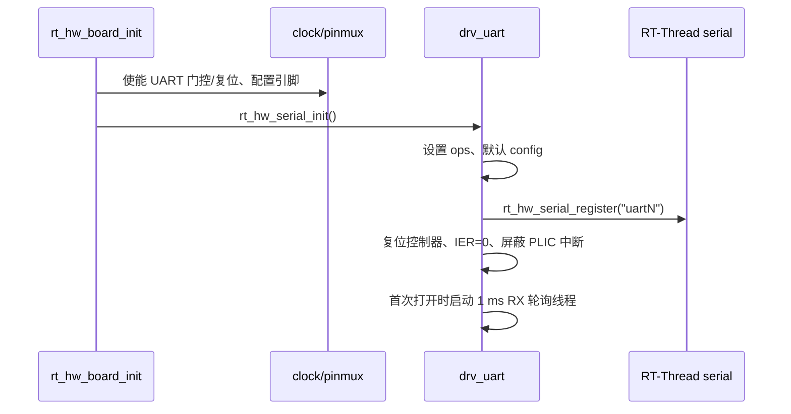

# 07 UART 开发手册

## 7.1 硬件能力

D21x 提供 8 个 UART 实例（UART0-UART7），本 BSP 全部支持编译。D213 demo128 实际引出的实例：

| 实例 | 引脚 | 用途 | 备注 |
|---|---|---|---|
| UART0 | PA.0/PA.1 | 调试控制台 | 默认启用 |
| UART1 | PA.4/PA.5 | RS-232 | 可选 |
| UART2 | PA.8/PA.9 | 串口 | 与 I2C2 冲突 |
| UART4 | PB.6/PB.7 | 串口 | 与 SDMC0/QSPI0 冲突 |
| UART7 | PF.6..PF.9 | BT HCI（WLAN/BT 模组） | TX/RX/RTS/CTS，功能 5；需 `BSP_USING_UART7` |
| UART3/5/6 | 未定义 | — | 可编译，需板级 pinmux |

输入时钟：48 MHz。最大波特率受控制器和引脚质量限制；常见 115200、921600、1.5 Mbps 可用，但**尚未做误码率测试**。

## 7.2 驱动组织

- `../libraries/soc/d21x/drivers/drv_uart.c`：RT-Thread serial v1 适配；
- `board/clock.c`：UART 门控；
- `board/pinmux.c`：UART 引脚；
- 原厂 UART HAL 没有复制；当前驱动是 BSP 自有实现，寄存器序列参考 `aic_hal_uart.c`。

为什么不用原厂 `drv/uart`：

- 原厂驱动依赖 `aic_osal`、DMA、RS485 和 PM；
- 当前需求是稳定的 poll + RX 轮询，外加可选的 TX DMA（7.10）；
- 自有实现约 300 行（不含 DMA），容易审查和裁剪。

这不违反“优先复用”原则：UART 是简单控制器，且现有最小实现已经实机验证；引入原厂完整驱动会增加 DMA/RS485/PM 依赖，收益不足。

## 7.3 Kconfig

```text
BSP_USING_UART0   (default y)
BSP_USING_UART1
BSP_USING_UART2
BSP_USING_UART3
BSP_USING_UART4
BSP_USING_UART5
BSP_USING_UART6
BSP_USING_UART7
BSP_UART7_AUTO_FLOW_CTRL (default n, depends on BSP_USING_UART7)
BSP_UART_CLK_FREQ (default 48000000)
BSP_USING_UART_DMA (default n, depends on BSP_USING_DMAC)
```

每个 UART 会 `select RT_USING_SERIAL`。串口框架版本为 v1（`RT_USING_SERIAL_V1`）。
`BSP_USING_UART_DMA` 打开串口框架的 `RT_SERIAL_USING_DMA`，允许以
`RT_DEVICE_FLAG_DMA_TX` 打开设备。

## 7.3.1 时钟门控的坑

Bootloader 只配置 UART0 的功能时钟分频，UART1..7 的分频字段保持 0，导致
这些实例的模块时钟停止：寄存器读出全 0，发送 FIFO 永远不排空。`board/clock.c`
在使能门控前把 UART0 的分频值复制到目标实例（UART CMU 寄存器
`0x0840 + n*4`，分频字段 bits[4:0]）。所有实例共用同一父时钟和
`BSP_UART_CLK_FREQ`，因此复制是安全的。

## 7.4 初始化流程



`aic_uart_configure()` 会在首次打开/配置时设置：

- 数据位 5-8；
- 停止位 1/2；
- 校验 none/odd/even；
- 波特率分频；
- FIFO 使能和复位；
- RX 使能。

## 7.5 使用示例

### 发送

```c
rt_device_t dev = rt_device_find("uart1");
rt_device_open(dev, RT_DEVICE_FLAG_RDWR | RT_DEVICE_FLAG_INT_RX);
rt_device_write(dev, 0, "hello\r\n", 7);
```

`rt_device_write()` 最终调用 `aic_uart_putc()`，逐字节等待 THRE。启用
`BSP_USING_UART_DMA` 并以 `RT_DEVICE_FLAG_DMA_TX` 打开设备后，改为走
7.10 的外部 DMAC 路径。

### DMA 发送

```c
rt_device_open(dev, RT_DEVICE_FLAG_RDWR | RT_DEVICE_FLAG_INT_RX |
                    RT_DEVICE_FLAG_DMA_TX);
rt_device_write(dev, 0, buf, len);   /* buf 需 8 字节对齐 */
```

`RT_DEVICE_FLAG_DMA_TX` 必须在 `rt_serial_open()` 前出现在设备的注册标志里，
否则打开返回 `-RT_EIO`。写接口的语义不变：一次 `rt_device_write()` 返回缓冲区
长度，实际发送在 DMA 完成中断里结束。

### 接收

```c
static struct rt_semaphore rx_sem;

static rt_err_t rx_ind(rt_device_t dev, rt_size_t size)
{
    rt_sem_release(&rx_sem);
    return RT_EOK;
}

rt_device_set_rx_indicate(dev, rx_ind);
rt_device_open(dev, RT_DEVICE_FLAG_RDWR | RT_DEVICE_FLAG_INT_RX);

while (1)
{
    char buf[64];
    rt_size_t n;

    rt_sem_take(&rx_sem, RT_WAITING_FOREVER);
    n = rt_device_read(dev, 0, buf, sizeof(buf));
    if (n)
        process(buf, n);
}
```

### 修改波特率

```c
struct serial_configure cfg = RT_SERIAL_CONFIG_DEFAULT;

cfg.baud_rate = 921600;
cfg.data_bits = DATA_BITS_8;
cfg.stop_bits = STOP_BITS_1;
cfg.parity = PARITY_NONE;
rt_device_control(dev, RT_DEVICE_CTRL_CONFIG, &cfg);
```

## 7.6 中断行为

UART 的 PLIC 中断线保持屏蔽（IER=0），D21x UART0 的 IRQ 76 还会在没有中断源时
持续 pending，因此 RX 不走中断：`RT_DEVICE_CTRL_SET_INT` 启动一个 1 ms 周期的
轮询线程，线程检查 `LSR.DR` 后调用 `rt_hw_serial_isr(RX_IND)` 把 FIFO 数据搬进
串口框架的 ring buffer。TX 不使用 UART 中断；DMA 完成由 DMAC 自己的中断回调
通知（见 7.10）。

RX FIFO 触发级别为 1/2（FCR 设置）。串口框架的 ring buffer 默认 64 字节
（`RT_SERIAL_RB_BUFSZ`）。1 ms 的轮询周期意味着 115200 下每个周期最多约
11 字节，ring 不会溢出；更高波特率时应增大 `RT_SERIAL_RB_BUFSZ`，或把
RX 改回 UART 中断/DMA。

## 7.7 错误处理

当前 `aic_uart_getc()` 读取 LSR 并在有错误标志时继续读数据；没有向上层报告 parity/framing/overrun。应用如果需要错误统计，应扩展 serial ops 或直接读 LSR。

已知限制：

- DMA 只支持 TX；RX 仍是 1 ms 轮询 + ring buffer；
- 仅 UART7 支持 RTS/CTS 自动流控（`BSP_UART7_AUTO_FLOW_CTRL`）；其余实例无硬件流控；
- 无 RS485 方向控制；
- 无 9-bit 模式；
- 无软件流控；
- 未做长时间误码率/压力测试。

## 7.8 板级注意事项

1. UART2 与 I2C2 共用 PA.8/PA.9；
2. UART4 与 SDMC0/QSPI0 共用 PB.6/PB.7；
3. UART1 连接到 RS-232 收发器，电平为 RS-232，不是 TTL；
4. RS485 的 DE/RE 控制尚未实现，不能直接把 UART 当 RS485 使用；
5. 修改 pinmux 时，先确认没有其他已启用外设占用同一引脚。

## 7.9 测试建议

- 回环：TX 短接 RX，发送递增字节，检查接收一致性；
- 双机：两块板交叉连接 TX/RX/GND，跑 115200/921600；
- 长时间：连续传输 1 MB，统计丢字节和 overrun；
- 错误注入：故意发送错误校验位，确认 LSR 标志；
- 热插拔：反复插拔串口线，确认没有锁死。

上表的外部对端测试目前**未执行**。MCR 内部回环只在控制器内部生效，能验证
控制器数据和 DMA 通路，不能替代 RS-232 电平、线缆和误码率测试。

## 7.10 UART TX DMA（外部 DMAC）

`BSP_USING_UART_DMA` 把普通写请求交给外部 DMAC：

- 每次 `rt_device_write()` 申请一个空闲通道，DRQ 号为 `DMA_ID_UART0 + n`；
- 数据先复制到每实例一个的 8 字节对齐暂存区（`dma_tx_stage`，256 B），
  暂存区再按 256 B 分片交给 DMAC；调用方缓冲区不需要对齐，长度也不受限；
- 源按 1 字节、单次 burst 配置，目标为 UART THR；
- 每片启动前设置 `FCR.DMA_MODE`、TX/RX 触发级别、`HSK=0xe5`，并置
  `HALT.TX_DRQ`，**不复位 TX/RX FIFO**：复位会丢掉上一片还留在 FIFO 里的
  数据（连续发送时），并破坏同时在接收的数据；
- DMAC 完成中断回调里关闭 TX DRQ、停止通道；还有剩余分片就继续启动，
  最后一片完成后释放通道并调用 `rt_hw_serial_isr(TX_DMADONE)`；
- 没有空闲通道时回退到 `aic_uart_putc()` 轮询发送，写接口不会丢数据；
- `rt_device_close()`（`CLR_INT` 带 `DMA_TX`）会中止在途传输，避免完成中断
  访问已经释放的串口 DMA 队列；在途传输期间修改波特率/数据格式返回
  `-RT_EBUSY`（重配置会复位 FIFO 并改分频，会破坏正在进行的 DRQ 传输）；
- 一个低优先级守护线程每 100 ms 检查一次：某一片超过 5 s 未完成就中止、
  打印告警并推进串口 DMA 队列，控制器错误不会永久卡死后续写操作。

相关 Kconfig：`BSP_USING_DMAC` → `BSP_USING_UART_DMA`（自动 select
`RT_SERIAL_USING_DMA`）。配置片段：`configs/d213-uart-dma-utest.config`。

### 验证命令

```text
msh > uart_dma_test 4096         # 单片回环
msh > uart_dma_stream 4096 513   # 8 个分片连续排队，奇数长度使分片起始地址不对齐
msh > uart_dma_close             # 传输中关闭，再重新打开验证
msh > utest_run bsp.d213.uart1.dma
```

测试使用 `MCR` 内部回环，不需要外部连线。单包与多包测试的收端**直接读
硬件 FIFO**，避免 1 ms RX 轮询线程在刷新和发送之间把空闲线字节塞进 ring；
`mixed_rx` 用例则改用标准 `INT_RX` + ring，验证 TX DMA 与正常接收路径
同时工作的数据完整性。测量值受 115200 波特率限制（约 11.5 KB/s），
不代表 DMAC 上限。

### 证据等级

| 项目 | 等级 | 说明 |
|---|---|---|
| 单包 64 B / 1 KiB / 4 KiB、4 B 拒绝 | HW PASS | HIL `20261107-205624-5680` |
| 8 分片连续排队 / 奇数分片长度 / 对齐 8 KiB | HW PASS | HIL `20261108-020309-21624`，套件 9/9 |
| 通道全部占满时的轮询回退 | HW PASS | 同上（8 通道全部被测试占用） |
| 传输中关闭设备后重新传输 | HW PASS | 同上 |
| TX DMA 与标准 `INT_RX` ring 并发 | HW PASS | 同上 |
| 外部 RS-232 对端 / 高波特率 / 误码率 | 未测试 | 需要外部设备 |

首轮实机回归还在测试辅助代码里发现并修复了一个缺陷：流式用例在
`rt_thread_delete()` 里删除了一个入口已返回的动态线程，而 RT-Thread 5.x
已由 idle 线程回收该对象，导致断言。修复后重跑通过。

## 7.11 BT HCI 端口（UART7）

D213ECV-DEMO-V4-0 的 Wi-Fi/蓝牙模组（RTL8733BS）把 BT HCI 接在 UART7 上：

| 信号 | 引脚 | 功能 | 上拉 |
|---|---|---|---|
| TX | PF.6 | 5 | 无 |
| RX | PF.7 | 5 | 上拉 |
| RTS | PF.8 | 5 | 无 |
| CTS | PF.9 | 5 | 上拉 |

配置：

```
CONFIG_BSP_USING_UART7=y
CONFIG_BSP_UART7_AUTO_FLOW_CTRL=y
```

`BSP_UART7_AUTO_FLOW_CTRL` 让 `aic_uart_configure()` 写
`MCR = 0x22`（RTS 控制 + 自动流控，取自原厂
`AIC_UART_MCR_FLOW_CTRL`）：控制器按 RX FIFO 占用自动驱动 RTS，并在
CTS 无效时停止发送。其它实例仍然写 `MCR = 0`，行为不变。

注意两点：

- CTS 没有被驱动（悬空为低）时，发送会被永久挂起，因此只有在
  4 线连接时才打开该选项；
- 本 BSP 只提供 HCI 端口本身，不包含蓝牙协议栈、固件加载和 HCI 传输层。

### 验证

`utest/tc_uart7.c`（套件 `bsp.d213.uart7`）用控制器内部 `MCR` 回环
（TXD 内部路由回 RXD）验证：设备注册、打开、默认 115200 8N1、发送
32 字节并逐字节收回。测试期间临时关闭自动流控，结束后恢复原 MCR。
这覆盖时钟、引脚功能、波特率分频、RX 轮询线程和标准设备 API，但
**不能**验证 RTS/CTS 本身（需要模组作为对端）。

`d213-sdio-utest` 配置同时打开 SDMC2 与 UART7，因为二者属于同一个
模组；该目标的 HIL 运行会同时包含 `bsp.d213.sdio` 和
`bsp.d213.uart7` 两个套件。2026-11-08 实机（HIL
`20261108-064913-21800`）：`bsp.d213.uart7` PASS，32 字节内部回环
逐字节一致。
