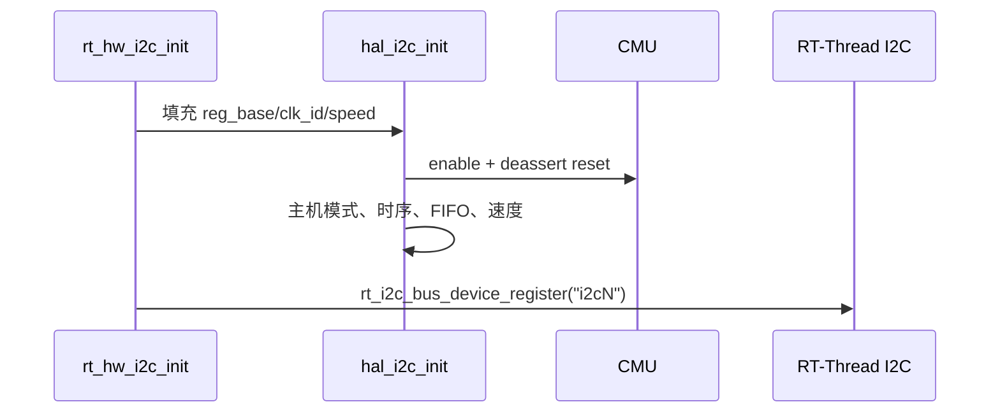

# 08 I2C 开发手册

## 8.1 硬件能力

D21x 提供 4 个 I2C 控制器。D213 demo128 的可用总线：

| 总线 | 引脚 | 典型用途 | 状态 |
|---|---|---|---|
| I2C0 | PD.6/PD.7 | 外部传感器/EEPROM | 可选 |
| I2C1 | PD.18/PD.19 | 外部器件 | 可选 |
| I2C2 | PA.8/PA.9 | 与 UART2 共用 | 可选 |
| I2C3 | PA.10/PA.11 | 电容触摸 | 官方 defconfig 启用 |

支持：

- 主机模式；
- 7-bit 地址；
- 10-bit 地址（按总线配置）；
- 标准模式 100 kHz、快速模式 400 kHz；
- 连续读写和重复起始条件；
- SCL/SDA stuck 检测与总线恢复。

不支持/未接入：

- 从机设备注册；
- I2C DMA；
- SMBus 协议层；
- 多主机仲裁的完整测试。

## 8.2 驱动组织

- `../libraries/hal/i2c/hal_i2c.c`：原厂 I2C 控制器 HAL（逐字节保持）；
- `../libraries/hal/i2c/hal_i2c.h`：原厂寄存器/结构定义；
- 该 HAL 位于共享层，D12p SDK 的 `hal_i2c.c`/`hal_i2c.h` 与其字节级
  一致（见 `../../d126fxr-demo-v1-1/docs/05-ip-compatibility.md`），D126 后续
  只需补 CMU/pinmux 即可 `select AIC_USING_HAL_I2C`；
- `../libraries/drivers/i2c/drv_i2c.c`：RT-Thread I2C 总线适配；适配器主体只调用 `hal_i2c_*`，实例表使用 SoC 层提供的 `I2Cx_BASE`/`I2Cx_IRQn`/`CLK_I2Cx`。由 `AIC_USING_DRV_I2C` 选择，D12p 需补这些常量、时钟/复位和 pinmux 后即可复用。

适配层只实现 `master_xfer` 和 `RT_I2C_DEV_CTRL_CLK`。HAL 的 `hal_i2c_master_send_msg()`/`hal_i2c_master_receive_msg()` 是**阻塞轮询**实现，使用 `aic_get_time_ms()` 做超时。

## 8.3 Kconfig

```text
BSP_USING_I2C0 / I2C1 / I2C2 / I2C3
BSP_I2Cn_SPEED   (default 400000)
BSP_I2Cn_10BIT   (default n)
```

启用任一实例会 `select RT_USING_I2C`。注意 RT-Thread 的 I2C Kconfig 默认还会选中 `RT_USING_I2C_BITOPS`；它只是编译了软件 I2C 框架，不会自动注册设备。

## 8.4 初始化流程



`hal_i2c_init()` 还会：

- 设置 SDA hold/setup 时间；
- 配置 7/10-bit 地址模式；
- 使能 SCL/SDA stuck timeout 和恢复；
- 设置 FIFO 阈值。

## 8.5 使用示例

### 读寄存器

```c
static rt_err_t read_reg(struct rt_i2c_bus_device *bus,
                         rt_uint8_t addr, rt_uint8_t reg,
                         rt_uint8_t *value)
{
    struct rt_i2c_msg msgs[2];

    msgs[0].addr = addr;
    msgs[0].flags = RT_I2C_WR;
    msgs[0].len = 1;
    msgs[0].buf = &reg;

    msgs[1].addr = addr;
    msgs[1].flags = RT_I2C_RD;
    msgs[1].len = 1;
    msgs[1].buf = value;

    return (rt_i2c_transfer(bus, msgs, 2) == 2) ? RT_EOK : -RT_EIO;
}
```

### 扫描总线

```text
msh > i2c_scan i2c3
scanning i2c3 ...
  found device at 0x38
  found device at 0x5d
2 device(s) found
```

`i2c_scan` 对 0x08-0x77 逐个发起 1 字节读；有 ACK 即认为设备存在。它不会识别地址冲突或多个设备共用地址的情况。

## 8.6 时序与异常

HAL 速度计算使用模块时钟 24 MHz：

- ≤100 kHz：标准模式；
- 100-400 kHz：快速模式；
- >400 kHz：HAL 会打印警告并回退到快速模式。

SCL/SDA stuck 检测时间由 `AIC_I2C_STUCK_TIME = 400`（以波特率周期计）配置。总线被从机拉死时，HAL 会尝试总线恢复。

超时来自 `hal_i2c_wait_bus_free()` 和 FIFO 等待，默认 10 ms 级别。若从机时钟拉伸时间很长，可能误判超时；需要按器件手册调整。

## 8.7 10-bit 地址

`BSP_I2Cn_10BIT` 是**整条总线**的属性，不是单个消息的属性。启用后：

- 控制器进入 10-bit 主机模式；
- 所有消息地址都按 10-bit 解释；
- 不能在同一总线上混用 7-bit 和 10-bit 从机。

RT-Thread 消息里的 `RT_I2C_ADDR_10BIT` 标志当前不会被适配层单独处理；请用 Kconfig 配置整条总线。

## 8.8 已知限制

- 仅主机模式；
- 阻塞传输，传输期间占用调用线程；
- 没有 I2C 中断/DMA；
- 没有从机回调注册；
- 没有总线锁的额外保护（RT-Thread I2C 核心已有互斥量）；
- 未做 400 kHz 长时间压力测试；
- EEPROM 等其他具体从机驱动不在本 BSP 内；GT911 触摸驱动见
  [13-display-lvgl.md](13-display-lvgl.md)。

## 8.9 测试建议

1. 用已知 EEPROM 或传感器验证单字节读写；
2. 用逻辑分析仪检查 START/重复 START/STOP 和 ACK；
3. 扫描总线，确认没有地址冲突；
4. 拔掉从机，确认超时返回而不是死锁；
5. 人为拉低 SDA，验证 stuck 恢复；
6. 连续读写 10 万次，统计错误。

当前状态：I2C3/GT911 已实机访问；以上 EEPROM、逻辑分析仪和 10 万次压力等测试未执行。
