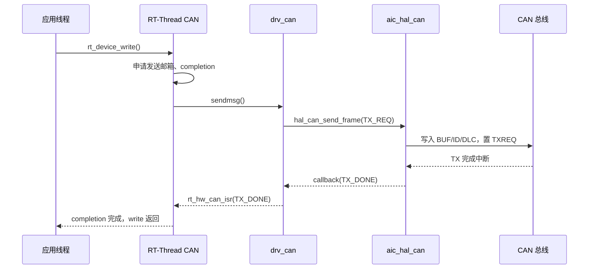

# 09 CAN 2.0A/B 专项文档

## 9.1 结论先行

D21x 的 CAN 控制器是**经典 CAN 2.0A/B**：

- 2 个控制器：CAN0、CAN1；
- 标准帧 11-bit ID；
- 扩展帧 29-bit ID；
- 数据帧和远程帧；
- 数据长度 0-8 字节；
- 最高 1 Mbps（控制器能力）。

**不支持：**

- CAN FD；
- 64 字节数据帧；
- BRS（Bit Rate Switching）；
- CAN FD 的 CRC/填充规则。

因此本 BSP：

- 不编译 `hal/canfd`；
- 不编译 `drv/canfd`；
- 不暴露 `RT_CAN_USING_CANFD`；
- 不把 CAN FD 作为测试目标。

即使 Luban-Lite 中存在 `bsp/artinchip/hal/canfd/` 和 `bsp/artinchip/drv/canfd/`，也不能据此认为 D21x 支持 CAN FD。

## 9.2 硬件与板级资源

| 控制器 | 基地址 | 中断 | 引脚 | 收发器 |
|---|---|---|---|---|
| CAN0 | `0x19230000` | 88 | PE.16/PE.17 | demo128 板载 |
| CAN1 | `0x19231000` | 89 | PE.18/PE.19 | demo128 板载 |

总线测试还需要：

- CAN_H/CAN_L 双绞线；
- 总线两端各 120 Ω 终端；
- 至少一个对端节点；
- 共地；
- 正确的波特率。

仅编译通过或仅初始化控制器，不能证明总线通信成功。

## 9.3 驱动组织

```text
applications/periph_test.c   can_send / can_dump
../libraries/soc/d21x/drivers/drv_can.c            RT-Thread CAN 设备适配
../libraries/soc/d21x/hal/aic_hal_can.c     原厂控制器 HAL（未修改）
../libraries/soc/d21x/include/aic_hal_can.h 寄存器/结构定义（未修改）
```

`../libraries/soc/d21x/drivers/drv_can.c` 的职责：

- 把 `struct rt_can_msg` 转换为 `can_msg_t`；
- 把 RT-Thread 模式映射为 `TX_REQ`/`SINGLE_TX_REQ`/`SELF_REQ`；
- 把 RT-Thread 过滤器转换为 `can_filter_config_t`；
- 把 HAL 回调转换为 `rt_hw_can_isr()`；
- 填充 `struct rt_can_status`。

位时序、错误计数、bus-off 处理仍在 HAL 中。

## 9.4 位时序

HAL 使用 24 MHz 模块时钟，按以下约束搜索位时序：

```text
sync_seg = 1
tseg1 = 1..16
tseg2 = 1..8
sjw   = 1..4
brp   = 1..64
```

采样点目标：

| 波特率 | 目标采样点 |
|---|---|
| > 800 kbps | 75% |
| > 500 kbps | 80% |
| ≤ 500 kbps | 87.5% |

常用波特率：

- 1 Mbps：BRP 较小，采样点靠近 75%；
- 500 kbps：80%；
- 250 kbps：87.5%；
- 125 kbps：87.5%；
- 100 kbps 及以下：87.5%。

如果总线长度较长或收发器延迟较大，应重新评估采样点，不能只改波特率。

## 9.5 帧格式

### 标准数据帧

```c
struct rt_can_msg msg = {0};

msg.id = 0x123;          /* 11-bit */
msg.ide = RT_CAN_STDID;  /* 0 */
msg.rtr = RT_CAN_DTR;    /* 0 */
msg.len = 8;
memcpy(msg.data, data, 8);

rt_device_write(can_dev, 0, &msg, sizeof(msg));
```

### 扩展数据帧

```c
msg.id = 0x18FF1234;     /* 29-bit */
msg.ide = RT_CAN_EXTID;  /* 1 */
msg.rtr = RT_CAN_DTR;
msg.len = 8;
```

### 远程帧

```c
msg.rtr = RT_CAN_RTR;
msg.len = 0;             /* 远程帧不携带数据 */
```

接收端通过 `msg.ide`/`msg.rtr`/`msg.len` 区分。

## 9.6 过滤器

控制器支持：

- 单过滤器模式（1 个过滤器）；
- 双过滤器模式（2 个过滤器）；
- 标准帧/扩展帧；
- 数据帧/远程帧；
- 关闭过滤器时接收全部。

RT-Thread 侧使用 `RT_CAN_CMD_SET_FILTER`：

```c
struct rt_can_filter_item items[1] =
{
    RT_CAN_FILTER_STD_INIT(0x123, RT_NULL, RT_NULL),
};
struct rt_can_filter_config cfg =
{
    .count = 1,
    .actived = 1,
    .items = items,
};

rt_device_control(can_dev, RT_CAN_CMD_SET_FILTER, &cfg);
```

限制：

- 最多 2 个过滤器；
- 双过滤器模式下，两个过滤器必须同为标准帧或同为扩展帧；
- 双扩展过滤器只比较 ID[28:13]，低位不参与硬件过滤；
- `count == 0` 表示关闭过滤、接收全部（本 BSP 的实现）。

## 9.7 工作模式

| RT-Thread 模式 | HAL 行为 | 发送 |
|---|---|---|
| `RT_CAN_MODE_NORMAL` | 正常模式 | `TX_REQ`，默认自动重传 |
| `RT_CAN_MODE_LISTEN` | 只听模式 | 禁止发送 |
| `RT_CAN_MODE_LOOPBACK` | 自接收请求 | `SELF_REQ` |
| `RT_CAN_MODE_LOOPBACKANLISTEN` | 只听 + 自接收 | 当前返回模式错误 |

说明：

- 本适配层没有暴露“单次发送/禁止自动重传”的 RT-Thread 标准命令，因为 RT-Thread 5.3 的 CAN 框架没有对应命令；
- HAL 内部支持 `SINGLE_TX_REQ`，但当前只能通过修改适配层使用；
- `RT_CAN_MODE_LOOPBACK` 是否能在无外部收发器的情况下完成回环，取决于控制器自接收路径和板级硬件，**未实机验证**。

## 9.8 发送与接收流程



接收：

```c
static struct rt_semaphore rx_sem;

static rt_err_t rx_ind(rt_device_t dev, rt_size_t size)
{
    rt_sem_release(&rx_sem);
    return RT_EOK;
}

rt_device_set_rx_indicate(can_dev, rx_ind);
rt_device_open(can_dev, RT_DEVICE_FLAG_INT_RX);

while (1)
{
    struct rt_can_msg msg;

    rt_sem_take(&rx_sem, RT_WAITING_FOREVER);
    while (rt_device_read(can_dev, 0, &msg, sizeof(msg)) == sizeof(msg))
        handle_frame(&msg);
}
```

## 9.9 错误状态与 Bus-off

HAL 维护：

- `recverrcnt` / `snderrcnt`；
- `biterrcnt` / `formaterrcnt` / `stufferrcnt` / `othererrcnt`；
- `ackerrcnt` / `crcerrcnt`；
- `current_state`：Active / Warning / Passive / Bus-off；
- `autoBusoff`。

本 BSP 在注册时设置 `autoBusoff = 1`。检测到 bus-off 后，HAL 会尝试释放复位模式恢复控制器。恢复是否成功取决于总线是否恢复正常。

RT-Thread 状态读取：

```c
struct rt_can_status status;
rt_device_control(can_dev, RT_CAN_CMD_GET_STATUS, &status);
```

注意：`status.errcode` 当前填入的是 HAL 的 `can_state_t`（0=Active，1=Warning，2=Passive，4=Bus-off），不是 RT-Thread `RT_CAN_BUS_ERR` 枚举。应用应按 `can_state_t` 解释，或后续在适配层做显式映射。

## 9.10 MSH 测试命令

```text
msh > can_baud can0 500000
msh > can_mode can0 normal
msh > can_send can0 0x123 11 22 33 44
msh > can_dump can0 5
```

`can_send`：

- 打开 `INT_RX | INT_TX`；
- 发送标准数据帧；
- 默认使用设备当前配置（注册默认 1 Mbps）。

`can_dump`：

- 打开 `INT_RX`；
- 等待最多 5 帧，每帧超时 3 秒；
- 打印 ID、IDE、RTR、DLC 和数据。

`can_baud` 在打开设备后设置经典 CAN 位速率，范围 1..1,000,000 bit/s；`can_mode` 支持 `normal`、`listen`、`loopback`。应用代码中对应：

```c
rt_device_control(can_dev, RT_CAN_CMD_SET_BAUD, (void *)CAN500kBaud);
rt_device_control(can_dev, RT_CAN_CMD_SET_MODE,
                  (void *)(rt_ubase_t)RT_CAN_MODE_NORMAL);
```

## 9.11 总线测试接线

```text
D213 CAN_H ──────── 对端 CAN_H
D213 CAN_L ──────── 对端 CAN_L
D213 GND   ──────── 对端 GND
两端各 120 Ω（或在开路时用两端终端）
```

测试步骤：

1. 确认收发器供电和使能；
2. 双方设置相同波特率；
3. 先让对端发送，D213 用 `can_dump` 接收；
4. 再让 D213 用 `can_send` 发送，对端确认；
5. 发送标准帧和扩展帧；
6. 发送 0-8 字节不同长度；
7. 发送远程帧；
8. 配置过滤器，确认只接收目标 ID；
9. 断开总线，观察错误计数和 bus-off；
10. 恢复总线，确认自动恢复；
11. 1 Mbps 连续发送，统计丢帧/错误。

**外部总线测试尚未执行。** CAN 控制器配置（打开、500 kbit/s、normal 模式、状态读取）已在 d213-utest 中 HW PASS（HIL `20261108-092325-14520`）；外部总线仍为 SKIP。

## 9.12 常见问题

| 现象 | 排查 |
|---|---|
| `can_send` 返回错误 | 是否已 `rt_device_open`；是否处于 LISTEN 模式；总线是否有 ACK |
| 发送成功但收不到 | 波特率、终端电阻、CAN_H/L 是否接反 |
| 一直 bus-off | 没有对端 ACK、波特率不一致、收发器未使能 |
| 过滤器不生效 | 标准/扩展帧是否匹配；双过滤器限制 |
| 只能收标准帧 | 过滤器配置为 `ide=0`；检查 `is_eff` |
| 收不到远程帧 | 过滤器 `rtr` 设置；确认对端发送的是远程帧 |
| 长时间运行丢帧 | 软件 RX FIFO 大小、线程优先级、总线负载 |

## 9.13 明确的非目标

- CANopen；
- UDS；
- J1939；
- CAN FD；
- 总线分析仪功能；
- 自动波特率检测。

这些属于应用层或专用工具，不应塞进 BSP。CANopenNode 等协议栈可以通过标准 `rt_device` CAN 接口接入。
