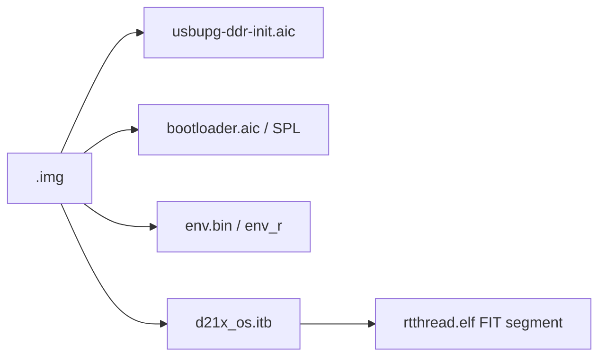

# 15 编译、打包与部署

## 15.1 环境要求

| 项目 | 已验证版本 |
|---|---|
| RT-Thread | v5.4.0 |
| 编译器 | Xuantie-900 elf newlib GCC V3.3.0（GCC 14.3.0）；V2.6.1（GCC 10.2.0）亦可 |
| Python | 3.13.15 |
| SCons | 4.8.1 |
| kconfiglib | 14.1.0 |
| PyCryptodomeX | 3.24.1（打包必需） |
| 主机 | Windows / Linux / macOS（Apple Silicon 已验证） |

其他 RISC-V GCC 版本（如上游 GCC 12/13）理论上可用，但必须：

- 支持 `rv64imafdc`；
- 支持 `-mcmodel=medany`；
- 链接 newlib 或等价的 libc；
- 通过 `rtconfig.py` 的 ISA tag 检测（GCC ≥12 需要 `_zifencei`）。

## 15.2 目录与配置

```text
.config                         唯一的受 Git 管理配置
rtconfig.h                      由 .config 生成
```

默认 `.config` 已启用：

- UART0 控制台、UART1（RS-232）；
- GPIO；
- I2C3（触摸）；
- CAN0/CAN1；
- PWM0-2（PC.0-PC.5）；
- WDT、RTC；
- 1024×600 LVDS + DE Framebuffer；
- 双 Framebuffer；
- GE Normal；
- 外设/显示/GE MSH 测试命令。

LVGL 默认关闭。UART2/4、I2C0/1/2、PWM3（PC.6/PC.7，与面板使能冲突）等未使用实例保留 Kconfig 选项和驱动源码，可按需启用。

可复现配置位于 `configs/`：

| 文件 | 用途 |
|---|---|
| `d213-minimal.config` | 最小启动（UART0 + GPIO） |
| `d213-default.config` | 默认外设 + 显示 + GE + GT911 |
| `d213-utest.config` | 默认配置 + utest + SPI NAND 只读/scratch 读写/文件系统用例 |
| `d213-nand-readonly.config` | minimal + QSPI0/SPI NAND/MTD 只读 |
| `d213-sdcard.config` | minimal + SDMC1（IDMA）+ 启动自动挂载 FAT |
| `d213-sdcard-utest.config` | utest + SDMC1（IDMA）只读回归（关闭 PWM） |
| `d213-dma.config` | minimal + 外部 DMAC（8 通道）+ `dma_test` 自检 |
| `d213-dma-utest.config` | utest + 外部 DMAC（`bsp.d213.dmac`） |
| `d213-uart-dma-utest.config` | 同上 + `BSP_USING_UART_DMA`（`bsp.d213.uart1.dma`、`uart_dma_test`） |

SD 卡配置固定 `CONFIG_RT_MMCSD_STACK_SIZE=8192`。RV64 下该线程默认
2048 字节，在重新检查已插入卡（块设备注销路径）时会触发
`mmcsd_detect stack overflow`；8192 已覆盖当前识别和卸载路径。
SDIO 中断线程同样是 8192（`CONFIG_RT_SDIO_STACK_SIZE`），因为它会
同步执行一次完整的 SDMC 请求。

SDMC1 默认启用 `BSP_SDMC_USE_IDMA`（`select BSP_USING_DMA`），IDMA
失败 3 次会自动退回 CPU FIFO；运行时可用 `sd_dma 0|1` 切换并用
`sd_perf` 对比。`BSP_USING_DMA` 同时编译 `libraries/soc/d21x/drivers/drv_dma.c` 的通用
对齐/Cache 接口，UART TX 和音频播放已经复用。

外部 DMA 控制器默认关闭（`BSP_USING_DMAC=n`）。`d213-dma.config` 打开
它并提供 `dma_test`/`dma_dump`；`d213-dma-utest.config` 额外提供
`bsp.d213.dmac` 回归（2026-11-07 实机 4/4 PASS）。通道、描述符和完成
中断已验证；UART TX 已接入并通过 `bsp.d213.uart1.dma`（实机 4/4），
配置见 `d213-uart-dma-utest.config`；音频播放也已接入（`d213-audio-utest`，
`bsp.d213.audio` 实机 PASS，见 14.6）；SPI 接入时仍需按外设单独做实机验证。

使用某个配置：

```sh
cp configs/d213-nand-readonly.config .config
scons --pyconfig-silent
scons -j8
```

`drivers/SConscript` 在启用 SPI NAND 时调用
`tools/gen_nand_parts.py`，从 `pack/image_cfg.json` 生成
`build/spinand_parts_gen.h`。不要手工维护第二份分区常量。

## 15.3 修改配置

使用标准 RT-Thread menuconfig：

```sh
scons --menuconfig
scons --pyconfig-silent
scons -j8
```

启用 LVGL 9.6.0 时，还需要官方源码和外部原生适配组件（均不随 BSP 提交）：

```sh
git clone --branch v9.6.0 --depth 1 \
    https://github.com/lvgl/lvgl.git /path/to/lvgl-9.6.0
git clone https://github.com/boa-z/lvgl-aic-standalone.git \
    /path/to/lvgl-aic-standalone
export LVGL_DIR=/path/to/lvgl-9.6.0
export LVGL_AIC_DIR=/path/to/lvgl-aic-standalone
scons --menuconfig          # 打开 BSP_USING_LVGL
scons --pyconfig-silent
scons -j8
```

默认使用软件帧拷贝和 GT911 输入，详见
[13-display-lvgl.md](13-display-lvgl.md)。

不要直接使用 `scons --useconfig=...` 作为最终步骤，因为它只把文件转换为 `rtconfig.h`，不会重新计算 `select` 依赖（例如 `RT_USING_CAN`）。如果使用它，之后必须再执行 `scons --pyconfig-silent`。

## 15.4 menuconfig

```sh
scons --menuconfig
```

可配置：

- Board options：DDR 大小、中断栈、Bootloader 保留区、UART 输入时钟、CLINT 频率；
- On-chip Peripheral Drivers：GPIO、UART、I2C、CAN、PWM、WDT、RTC、SDMC1；
- RT-Thread 标准选项：FinSH、串口缓冲区、内存管理等。

`rtconfig.h` 必须由配置工具生成，禁止手改。

### 配置操作与工具链

`scons --menuconfig`、`scons --pyconfig`、`scons --pyconfig-silent`、`scons --defconfig`、`scons --help`、`scons -c` 和 `scons -n` 不执行目标编译器，因此未配置 `RTT_EXEC_PATH` 时也可以使用。

`link.lds` 在正常构建解析 SConstruct 时由 `board/link.lds.S` 预生成，输入为 `.config` 和 `rtconfig.h`；`menuconfig`、`pyconfig`、`clean`、`help` 会跳过预生成，因此配置操作不要求交叉编译器。修改配置后下一次真实构建会重新生成链接脚本再链接。

## 15.5 编译

```sh
scons -j8
```

产物：

| 文件 | 说明 |
|---|---|
| `rtthread.elf` | 可执行 ELF，入口 `0x40000000` |
| `rtthread.bin` | 裸二进制 |
| `rtthread.map` | 链接映射，排查符号/大小 |
| `link.lds` | 生成的链接脚本 |
| `build/` | 目标文件 |

清理：

```sh
scons -c
```

基础编译只依赖 RT-Thread 源码和 RISC-V 工具链；**不需要** Luban-Lite
SDK。`rtthread.elf`/`rtthread.bin` 是完整的 BSP 构建产物。只有生成可烧录
的原厂 `.img`（15.7）才需要 SDK 镜像工具和原厂 Bootloader/PBP/DDR 资产，
不能把打包步骤描述成基础编译的前提。

## 15.6 链接约束

`board/link.lds.S` 在构建时预处理：

```text
.text/.rodata/.data/.bss -> 0x40000000 起
interrupt stack
heap -> 0x47800000 结束
0x47B80000 -> Bootloader 保留
0x48000000 -> DDR 结束
```

链接脚本会断言：

- 数据/BSS 不越过堆；
- 堆不进入 Bootloader 保留区；
- 中断栈在 RAM 内；
- 入口为 `_start`。

如果新增大型静态数组或 framebuffer，先检查 `.bss` 和堆是否仍然满足约束。

## 15.7 固件打包

### 依赖

本地 Luban-Lite SDK 必须包含：

```text
tools/scripts/mk_image.py
tools/scripts/mkenvimage.py
tools/scripts/gen_partition_table.py
tools/scripts/mk_private_resource.py
target/d21x/demo128-nand/pack/bootloader.bin
bsp/artinchip/sys/d21x/d21x.pbp
```

`mkenvimage.py` 是 SDK 工具层提供的纯 Python 实现，输出与原厂
`mkenvimage` 二进制逐字节兼容，因此 macOS/Linux 不需要运行 Linux ELF，
Windows 也不需要 `mkenvimage.exe`。这些资产**不提交到本仓库**。

### Python 虚拟环境（uv）

在仓库根目录创建并激活虚拟环境：

```sh
uv venv .venv
source .venv/bin/activate          # Windows PowerShell: .venv\Scripts\Activate.ps1
uv pip install -r tools/requirements.txt
uv pip install pycryptodomex
```

`pycryptodomex` 用于 SDK `mk_image.py` 的 AIC 头、摘要和签名处理。SDK
自带的 `Cryptodome` 只包含 Windows/Linux 的原生扩展，macOS 必须使用虚拟
环境中的版本；`mk_image.py` 会优先加载当前 Python 环境的 `Cryptodome`，
仅在找不到时回退到 SDK 自带副本。`gmssl`、`asn1crypto`、`fdt` 等纯 Python
依赖仍由 SDK 提供。

`mk_firmware.py` 默认使用运行它的解释器（即已激活的 venv），不会自动选择
SDK 内的 `tools/env/tools/Python38/python3.exe`。如果未激活 venv：

```sh
python tools/mk_firmware.py --python /path/to/rt-thread/.venv/bin/python ...
```

### 命令

macOS / Linux：

```sh
export AIC_SDK_DIR=/path/to/luban-lite
python tools/mk_firmware.py \
    --sdk "$AIC_SDK_DIR" \
    --elf rtthread.elf \
    --out images
```

Windows PowerShell：

```powershell
$env:AIC_SDK_DIR = "C:\path\to\luban-lite"
python tools\mk_firmware.py --sdk $env:AIC_SDK_DIR `
    --elf rtthread.elf --out images
```

脚本会：

1. 复制 ELF 和打包配置；
2. 生成 `partition.json`/`partition_table.h`；
3. 生成 `ddr_init.bin`；
4. 生成 `d21x_os.its`/`d21x_os.itb`；
5. 生成 `bootloader.aic`、`env.bin`；
6. 组装最终 `.img`。

不会写设备。

### 验证

SDK 工具层的 `mkenvimage` 测试（如果系统安装了原生 `mkenvimage`，会额外做
逐字节对比）：

```sh
cd "$AIC_SDK_DIR/tools/scripts"
python -m unittest discover -s tests -v
```

### 输出

```text
images/
  d21x_os.itb
  bootloader.aic
  d21x_d213_demo128_page_2k_block_128k_v1.0.0.img
  ...
```

打包使用当前默认 `.config` 产生的 `rtthread.elf` 即可。

### 已验证的打包大小

| 配置 | `rtthread.bin` | `d21x_os.itb` | 最终 `.img` |
|---|---:|---:|---:|
| 默认 `.config`（GCC 16.1.0，含 GT911） | 116808 | 120832 | 970240 |

GCC 10.2.0 构建的旧显示固件为 `73504 / 75776 / 925184`，仅作历史参考。
ITB 按分区页/块对齐，因此 `text+data` 增加不总是等量反映到 ITB 大小。

## 15.8 固件布局



Bootloader 仍负责：

- SPL；
- DDR 初始化；
- NAND 分区；
- 镜像校验；
- USB/SD 升级。

BSP 不修改这些职责。

## 15.9 烧录

烧录工具和具体步骤取决于 ArtInChip 官方工具链/板卡。常见方式：

- USB 升级（原厂 Bootloader）；
- SD 卡升级；
- 量产烧录器。

本仓库不提供烧录脚本，也不会自动写设备。烧录前确认：

- 镜像与板卡型号匹配；
- 供电稳定；
- 串口已连接；
- 知道如何恢复变砖；
- 不要覆盖 Bootloader，除非明确知道后果。

## 15.10 常见构建失败

| 现象 | 原因 | 处理 |
|---|---|---|
| `riscv64-unknown-elf-gcc not found` | `RTT_EXEC_PATH` 未设置 | 设置工具链 `bin` 目录 |
| `No module named kconfiglib` | Python 缺包 | `pip install kconfiglib` |
| `No module named SCons` | SCons 未安装 | `pip install scons` |
| `undefined reference to hal_...` | 只加了驱动，没加 HAL 源 | 检查 `../libraries/SConscript` 的 `GetDepend` |
| `BSP_I2C0_10BIT undeclared` | Kconfig bool 未定义 | 驱动中提供默认宏 |
| `region DRAM overflowed` | 镜像/堆超限 | 检查 `.bss`、链接脚本 |
| `undefined reference to fabs` | 浮点库未链接 | 确认 GCC 内建/`-lm` |
| 链接脚本断言失败 | 堆与 Bootloader 重叠 | 检查 `AIC_BOOTLOADER_RESERVED_SIZE` |
| 打包脚本找不到 `mk_image.py` | SDK 路径错误 | 检查 `--sdk` |
| `Permission denied ... Python38/python3.exe` | 旧脚本在非 Windows 主机选择了 SDK 内置 Windows Python | 使用当前脚本；默认即为运行 `mk_firmware.py` 的 venv 解释器，也可显式传 `--python` |
| `No module named Cryptodome` / `Cannot load native module 'Cryptodome...'` | 当前 venv 未安装 PyCryptodomeX，或误用了 SDK 自带的异构二进制 | `uv pip install pycryptodomex`，确认使用的是已激活的 venv |
| `exec format error ... mkenvimage` | SDK 仍是旧版，调用了 Linux/Windows 原生 `mkenvimage` | 更新 SDK 工具层，确保存在 `tools/scripts/mkenvimage.py` |
| `The environment file is too large...` | `env.txt` 超过 `env` 分区大小 | 减小环境变量内容或调整分区，二者需与 Bootloader 约定一致 |
| 镜像启动无输出 | 入口/加载地址/分区错误 | 检查 FIT 和 Bootloader 日志 |

## 15.11 构建后检查清单

- [ ] `scons -j8` 无错误；
- [ ] `riscv64-unknown-elf-size rtthread.elf` 记录 text/data/bss；
- [ ] `rtthread.map` 中入口为 `_start`；
- [ ] 打包使用 uv venv，且已安装 `pycryptodomex`；
- [ ] SDK `tools/scripts/tests` 测试通过；
- [ ] 镜像大小小于 `os` 分区；
- [ ] 没有把 `images/`、`build/`、ELF 提交到 git；
- [ ] 当前 `.config` 与文档描述的功能一致；
- [ ] 如果改了外设，更新 [03-hardware.md](03-hardware.md) 矩阵；
- [ ] 如果改了 HAL，更新 [20-vendor-source-license.md](20-vendor-source-license.md)。

## V1.3.3 打包兼容性

当前 SDK 基准及来源清单见第 20 章。D213 的 `concatenate.bootloader.aic`
采用 V1.3.3 `{files, max_size: "404k"}` 形式；旧版打包脚本可能不支持此结构，
请使用固定快照对应脚本。已实际生成 IMG，并用 1 KiB 上限负例确认原厂脚本拒绝
超限 bootloader；没有烧写开发板，不能据此认定 ROM 启动成功。
